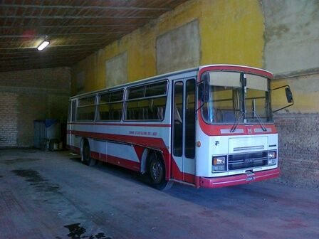
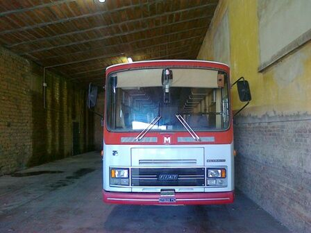

## Un progetto già realizzato: il Fiat 308 Menarini

Ringraziamo il Comune di Castiglione del Lago per la grande generosità dimostrata nel donare l'autobus alla nostra associazione. Il mezzo è arrivato ed è parcheggiato nel deposito di Castiglione del Lago, in attesa di un sito idoneo nel deposito di Perugia, così da poter essere riunito al Fiat 418 e creare un piccolo spazio museale.

Dobbiamo fare qualche "ritocchino", ma presto tornerà in ottima forma!

## Un po' più ambizioso: le filovie

A Perugia era attiva un'eccezionale rete filoviaria, smantellata alla fine degli anni '70. Siamo riusciti a rintracciare tre vecchie "filovie" (come venivano chiamate a Perugia) salvate dalla demolizione: abbiamo visionato i mezzi e inoltrato la richiesta di trattativa per riportarle a casa.

## Il grande sogno: un museo dei trasporti

Trovare un locale dove realizzare un Museo cittadino dei trasporti, in cui raccogliere in un percorso dei ricordi tutto ciò che è legato al mondo del trasporto pubblico: fotografie, filmati, vecchi biglietti, abbonamenti, divise…

…e tanti altri progetti, che scoprirete insieme a noi!
